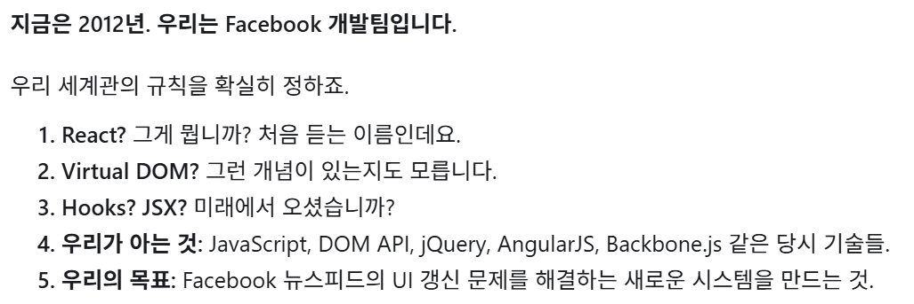

# 🛖 mini-react

> `mini-react`는 **브라우저에서 바뀐 부분만 새로 렌더링하는 웹 프론트엔드 프레임워크**다.

> *HTML, CSS, TypeScript와 브라우저 API만으로 Virtual DOM, Diff/Patch, 함수 컴포넌트와 Hooks를 구현한 학습용 프로젝트입니다.*

## ❌ 불편했던 기존의 개발 방식

```tsx
/* 개발자가 직접 데이터 변경과 DOM을 수정하는 기존의 개발 방식 */
let likes = 10;

const button = document.querySelector<HTMLButtonElement>("#like")!;
button.addEventListener("click", () => {
    likes++;

    // 개발자가 직접 DOM 갱신.
    // 만약 DOM 갱신을 까먹으면? -> UI에 보이는 likes와 실제 likes가 다를 수 있다!
    // likes를 보여줘야하는 UI가 여기저기에 흩어져있다면?
    button.textContent = `좋아요 ${likes}`;
});
```

- AJAX와 JavaScript를 이용하여 페이지를 새로고침하지 않고 일부 UI만 갱신할 수 있게 되었습니다. 하지만 **개발자가 데이터 변경과 DOM 갱신을 직접 관리해야 했습니다**.
    - 데이터 변경 후 **DOM 갱신 코드를 누락할 위험 →** 데이터와 실제 화면의 **불일치**
    - UI 요소 사이의 의존성 증가 → **유지보수 비용 상승**

## 🤬 불편했던 사용자 경험

- 개발자가 DOM 갱신 누락시 **실제 데이터는 변경되었으나 화면에는 이전 값이 남아있을 수 있었다**. 예를 들어 “좋아요”를 눌렀는데 숫자가 바뀌지 않거나 새로고침해야 최신 상태가 표시되는 문제를 들 수 있다. → 사용자의 UX 하락
- UI가 일부만 변경되었는데 전체 페이지를 새로 그려서, 화면 끊김이나 입력 반응 지연이 발생할 수 있었다.

## 🔜 구현 방향

```tsx
/* 상태에 따른 UI의 모습을 정의하는 새로운 개발 방식 */
function App(): VNode {
    const [likes, setLikes] = useState(10);

    // 좋아요 버튼이 눌릴 시 likes 상태가 하나 올라간다.
    // VDOM 생성 함수를 가정한 개념적 예시이다.
    return h(
        "button",
        { onClick: () => setLikes(n => n + 1) },
        `좋아요 ${likes}`
    );
}
```

> 우리는 데이터가 바뀌면 자동으로 렌더링해주는 프레임워크를 만들자.

- mini-react에서는 **현재 상태에서 UI가 어떤 모습이어야 하는지**를 작성한다.
- 하지만 상태가 바뀔 때마다 전체 DOM을 다시 렌더링하는 것은 비효율적이므로, **변경된 부분만 찾아 실제 DOM을 갱신**해야 한다.
- 이를 위해 무거운 실제 DOM을 `cloneNode()`로 복사해 비교하는 대신, **트리의 구조와 값만 가볍게 추출한 VDOM을 생성하고 과거 VDOM과 새 VDOM을 비교**하는 로직을 사용한다.

```tsx
/* 기존의 DOM */
<div>
  <h2>게시글</h2>
  <span>좋아요 10</span>
  <button>좋아요</button>
</div>
```

```tsx
/* DOM을 VDOM으로 변환 */
/* 이는 예시 변환일 뿐, 정확한 자료구조와 명세는 설계서에서 정의한다 */
const oldTree = {
  tag: "span",
  children: ["좋아요 10"]
};

const newTree = {
  tag: "span",
  children: ["좋아요 11"]
};
```

## 👍 특징

| **구분** | **기존 JavaScript** | **mini-react** |
| --- | --- | --- |
| UI 표현 | DOM 조작 명령 | State에 따른 UI 선언 |
| 데이터 관리 | 개발자가 직접 관리 | **useState** |
| DOM 갱신 | 개발자가 직접 수행 | Diff/Patch |
| 화면 동기화 | 수동 | **State 변경 시 자동** |
| UI 구성 | DOM 조작 코드 중심 | 재사용 가능한 Component 중심 |

## 🪡 실행 방법

Node.js와 npm을 준비합니다. 브라우저 테스트에는 Chrome/Chromium이 필요합니다. 저장소 루트에서 실행하세요.

```sh
npm ci
npm run build
```

빌드된 단독 HTML을 브라우저에서 엽니다. 소스를 수정하면 다시 빌드해야 합니다.

- [Phase 1 · HTML 편집기](demo/phase1/demo.html)
- [Phase 2 · 장바구니와 Hooks](demo/phase2/demo.html)
- [국제선 도착 전광판](demo/flight-board/demo.html)

## 🌲 레포 구조

```
src/phase1/            DOM ↔ VNode, Diff, Patch
src/phase2/runtime.ts  컴포넌트 생명주기와 Hooks
demo/                 HTML 편집기, 장바구니, 전광판
tests/                브라우저 회귀, 퍼징, 변이
docs/                 명세, 전략, 실행 결과와 분석
```

## 🌊 렌더링 과정

```
Phase 1 · DOM 갱신 엔진
HTML 편집 → 파싱·검증 → VNode·미리보기
Patch 클릭 → Diff(이전 VNode, 새 VNode) → Patch(실제 DOM) → 이력 저장

Phase 2 · 컴포넌트와 상태
사용자 이벤트 → Setter → State 변경 → 루트 함수 재실행 → 새 VNode
              → Diff → Patch → Effect 정리·실행
```

## 🪜 각 단계별 구현 과정

### Phase 1: Virtual DOM + Diff + Patch 검증기

- `테스트 영역`에 지원하는 HTML을 입력하면 검증된 **VNode와 미리보기를 즉시 생성**합니다.
- `실제 영역`에서는 `Patch` 버튼을 누를 때만 `테스트 영역`의 변경 사항을 반영합니다.
- 기본 Diff에서 `ul`·`ol`의 자식이 달라지면 목록의 자식을 다시 만듭니다.
- **변경된 영역을 2초간 강조**합니다. 혼합 콘텐츠의 텍스트는 Range 기반 오버레이로
표시하여 관리 중인 DOM 구조를 바꾸지 않습니다.
- **최대 10개 VNode 스냅샷을 저장**합니다. `뒤로가기/앞으로가기` 버튼으로 `실제 영역`, `편집기`, `미리보기`를 복원하고, 과거 위치에서 새 변경을 적용하면 이후 이력을 버립니다.
- 변경이 없으면 실제 영역의 DOM 쓰기와 이력 추가를 생략합니다.

### Phase 2: 함수 컴포넌트와 Hooks

- `h()`로 VNode를 만들고 `FunctionComponent`가 `mount/update/unmount`를 관리합니다. 런타임은 키 매칭을 활성화해 같은 키와 태그의 형제 DOM을 이동·재사용합니다.
- **루트 컴포넌트만 상태와 Hooks를 소유**합니다. 자식 컴포넌트는 `props`만 받습니다.
- `useState`, `useEffect`, `useMemo`, `defineHook`을 제공합니다.
- 카운터, 텍스트 입력, 체크박스, 계산 결과, Effect 로그를 확인할 수 있습니다.
  VNode는 현재 스냅샷과 이력 개수를 표시합니다.
- Reset은 새 인스턴스를 생성하고, Unmount/Mount로 정리 함수와 재생성을 관찰합니다.

### 타입과 입력 경계

- `VNode`는 요소(`type: 1`)와 텍스트(`type: 3`)를 구분하고, `Patch`는 작업 종류별 유니온으로 정의합니다. TypeScript의 `strict`를 사용합니다.
- 편집기는 HTML 태그·속성·URL 허용 목록을 검사합니다. 파싱한 주석은 제거합니다. 엔진의 `h()`와 `fromDOM()`은 편집기의 HTML 입력 검증과 별개의 경로입니다.

### 직접 구현한 세 가지 축

| **구현** | **역할** | **설계하면서 중요하게 본 점** |
| --- | --- | --- |
| **VNode** | DOM과 독립적인 요소·속성·텍스트 표현 | DOM 왕복 변환, 현재 입력 데이터 보존 |
| **Diff / Patch** | 변경 사항을 작업 목록으로 계산하고 실제 DOM에 적용 | 불필요한 쓰기 방지, 노드 정체성 유지 |
| **Component / Hooks** | 함수 실행과 State·Effect·Memo의 생명주기 관리 | 루트 State, Hook 슬롯과 호출 순서, 의존성 비교 |
- `diff()`는 DOM을 직접 수정하지 않고 아래 여섯 작업을 생성합니다.

    | Patch | 처리 |
    | --- | --- |
    | `INSERT` | 새 노드 삽입 |
    | `REMOVE` | 기존 노드 제거 |
    | `REPLACE` | 타입·태그·키가 다른 노드 교체 |
    | `UPDATE_TEXT` | 텍스트 값 수정 |
    | `UPDATE_PROPS` | 변경된 속성 반영 및 사라진 속성 제거 |
    | `MOVE` | 같은 부모 안에서 기존 노드 이동 |
- 키 매칭을 활성화하면 키가 있는 형제는 Map으로 이전 노드를 찾고, **키가 없는 자식은 키 없는 기존 자식끼리 순서대로 대응**시킵니다.
- 키 목록이 [A, B, C] → [C, A, B]로 바뀌면 **화면만 같게 만드는 것이 아니라 기존 DOM 객체를 이동해 재사용하도록 구현**했습니다.
- `indexOf`와 `splice`를 사용하므로 형제 수에 대해 **최악의 경우 이차 시간이 걸릴 수 있으며**, 대규모 목록용 최적화나 최소 이동 횟수를 보장하지 않습니다.

## 🤔 React와의 구현 차이

| 항목 | mini-react | React |
| --- | --- | --- |
| UI 표현 | `h('tag', props, children)`와 요소·텍스트 VNode. **JSX 변환 설정 없음** | JSX 또는 `createElement`로 컴포넌트와 UI 표현 |
| 컴포넌트 상태 | 루트 인스턴스의 `hooks[]`만 상태 소유. 자식 호출은 즉시 VNode로 평가 | **자식도 독립 상태를 소유**하고 트리상의 위치·타입·키로 상태 보존 |
| 갱신 범위 | setter가 루트 함수를 재실행하고 전체 반환 VNode 비교 | 상태 갱신이 해당 컴포넌트의 렌더를 요청하고 기본적으로 자식도 재귀 렌더 |
| 스케줄링 | 일반 setter는 즉시 동기 갱신. Effect 묶음 안에서만 갱신을 모음 | 이벤트 처리의 여러 상태 업데이트를 배치 처리 |
| 비교·반영 | 재귀 비교로 경로 기반 Patch 배열을 만든 뒤 순서대로 적용. **별도 Fiber·우선순위 스케줄러 없음** | 렌더와 커밋 단계를 구분하고 커밋에서 필요한 DOM 변경 반영 |
| 키 | 형제 DOM 요소 매칭에 사용하며 DOM의 `data-key`로도 출력 | 컴포넌트의 상태 보존·초기화에도 관여하는 식별자 |
| 사용자 훅 | `defineHook(useSomething)` 래퍼에서 실행 문맥과 이름 검사 | `useSomething()`을 직접 호출해 상태 로직 재사용 |
| `useState` 초기값 | 전달된 값을 그대로 저장. **지연 초기화 함수 실행 로직 없음** | 초기화 함수를 전달하는 지연 초기화 지원 |
| Effect 시점 | DOM 반영 뒤 동기적으로 실행 | 커밋 후 실행하며 상호작용 여부에 따라 paint 전후 시점이 달라질 수 있음 |
| 이벤트 | 컨테이너의 네이티브 `click` 리스너에서 이벤트 위임 | React 이벤트 객체와 이벤트 처리 체계 제공 |
| 제공 범위 | 세 가지 내장 훅과 명시적 생명주기, DOM 렌더링 | 더 넓은 Hook/API와 생태계 제공 |
| 이력 | 학습용 VNode 스냅샷과 Back/Forward UI 제공 | 이 프로젝트 형태의 VNode 이력 UI는 별도 구현 대상 |

React 공식 문서 링크와 세부 비교는 [React 구현 비교](docs/react-comparison.md)에 있습니다.

## 🙏 테스트

부분 갱신의 정확성, 키 기반 DOM 객체 재사용, 상태 전이와 테스트의 결함 탐지 능력을 확인합니다.

```sh
npm run typecheck
node tests/run-phase1-tests.mjs
node tests/run-phase2-tests.mjs
```

| 검증 방법 | 확인하는 내용 |
| --- | --- |
| 단위·통합·시나리오 | Phase 1 고유 27건, Phase 2 고유 14건을 단독 HTML과 ES 모듈 모드에서 각각 실행합니다. |
| 구조화된 퍼징 | seed를 사용해 DOM/VNode 왕복, Patch 결과의 동등성, 키 재정렬 시 노드 정체성을 검사합니다. |
| 변이 테스트 | 속성 처리 코드에 변이를 적용해 기준 테스트가 오류를 검출하는지 검사합니다. |

실행 명령과 환경 설정은 [테스트 실행 안내](tests/README.md), 기대 결과는 [테스트 목록](tests/TEST-CASES.md)에 있습니다. 저장된 수치는 병합 전 작업 트리의 실행 기록입니다. [실행 결과](docs/test-report.md), [변이·퍼징 분석](docs/testing-analysis.md)

## 🌧️ 알려진 한계

| 선택 | 이유와 효과 | 한계 |
| --- | --- | --- |
| **루트에서만 State·Hooks 관리** | 상태 흐름과 Hook 슬롯을 명확하게 추적 | 자식별 독립 State는 미지원 |
| **동기적인 State 갱신과 DOM 반영** | 실행 순서와 Diff/Patch 과정을 관찰하기 쉬움 | 일반적인 배치·우선순위 스케줄링 없음 |
| **DOM 반영 뒤 Effect 실행** | 의존성 변경과 Cleanup 순서를 구분 | 브라우저 Paint 이후 실행을 보장하지 않음 |
| **네이티브 `click` 이벤트 위임** | 갱신 후에도 컨테이너 리스너 하나 유지 | 일반화된 이벤트 시스템은 아님 |
| **배열 이동 기반 키 매칭** | 같은 키의 실제 DOM 재사용 | 대규모 정렬에서 이차 비용 가능, 최소 이동 횟수는 보장하지 않음 |
