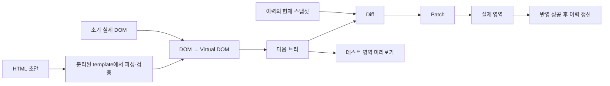
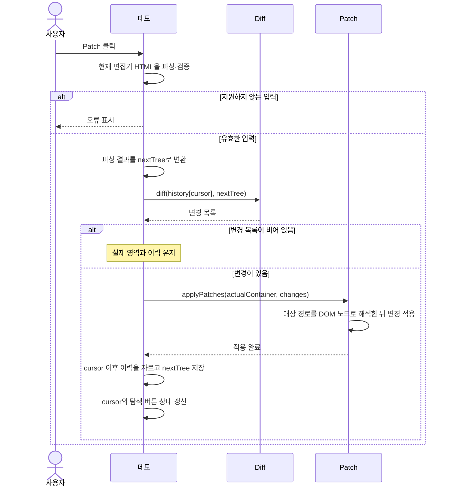
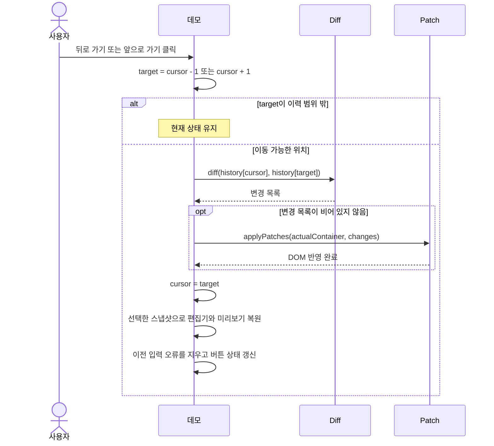

# mini-react 아키텍처

화면의 **이전 모습**과 **다음 모습**을 JavaScript 데이터로 표현한다. 비교는 데이터에서 끝내고, DOM 쓰기는 Patch에 모은다. 그러면 “어떻게 바꿀까”를 기능마다 작성하는 대신 “다음 화면은 어떤 모습인가”만 결정할 수 있다.

## 레포 구조

아래는 Phase 1의 파일 배치 계획이다. 최상위 `src/`, `tests/`, `docs/`를 사용하고, 엔진과 데모 코드는 각각 `src/engine/`, `src/demo/`에 둔다. 브라우저 진입점은 루트 `index.html`이며 `/src/demo/main.ts`를 불러온다.

```text
mini-react/
├─ README.md
├─ AGENTS.md
├─ index.html
├─ docs/
│  ├─ requirements.md
│  ├─ architecture.md
│  └─ testing.md
├─ src/
│  ├─ engine/
│  │  ├─ vnode.ts
│  │  ├─ dom.ts
│  │  ├─ diff.ts
│  │  └─ patch.ts
│  └─ demo/
│     ├─ main.ts
│     ├─ history.ts
│     ├─ validate.ts
│     └─ style.css
└─ tests/
   ├─ index.html
   └─ engine.test.ts
```

- `src/engine/`은 Virtual DOM 타입, DOM 변환, Diff, Patch를 제공한다. `diff.ts`는 브라우저 DOM 없이 동작한다.
- 루트 `index.html`은 샘플 HTML과 데모 진입 모듈을 연결한다. `src/demo/`는 편집기와 미리보기, 입력 검증, Patch 버튼, 이력 탐색을 맡는다. 의존 방향은 `demo → engine`이며 엔진은 데모를 가져오지 않는다.
- `tests/`는 브라우저 테스트 페이지와 엔진·이력·입력 검증 테스트를 담는다.
- Phase 2에서 `src/runtime/`을 추가해 함수형 컴포넌트와 Hooks를 구현하고 같은 엔진을 재사용한다.

## Phase 1 · 흐름과 경계



| 경계 | 계약 |
| --- | --- |
| Virtual DOM | `fromDOM(node)`는 DOM을 읽고, `toDOM(vnode, document)`는 분리된 노드를 생성한다. |
| Diff | `diff(previous, next)`는 Virtual DOM 트리 두 개를 받아 순서가 정해진 변경 목록을 반환한다. 브라우저 없이 호출할 수 있는 순수 함수다. |
| Patch | `patch(root, patches)`는 변경 목록을 실제 DOM에 적용하고 바뀐 DOM 노드들을 반환한다. 데모는 이 노드들을 2초간 빨갛게 표시한다. |
| 데모 | 초안의 파싱·검증, 버튼, 미리보기, 이력 인덱스를 담당한다. Phase 2는 데모를 거치지 않고 엔진을 재사용한다. |

실제 영역의 컨테이너 요소가 트리의 루트 `VNode`다. 초안의 루트는 현재 스냅샷의 루트와 같은 태그·속성으로 만들고 자식만 편집기에서 가져온다. 따라서 내용이 비어 있거나 최상위 태그가 여러 개여도 같은 규칙을 적용할 수 있고, 루트 자체는 교체되지 않는다.

위 흐름에서 초안 입력 이벤트는 파싱·검증 후 미리보기만 갱신한다. 실제 영역을 갱신하는 경로는 Patch 버튼과 이력 이동이다. Patch 버튼은 클릭 시점의 편집기 값을 읽고, 이력 이동은 저장된 트리를 목적지로 사용한다.

### Virtual DOM의 형태

노드 종류는 DOM의 `nodeType` 숫자를 그대로 쓴다. 별도의 `VTree` 타입은 두지 않고, 루트 `VNode` 하나가 그 아래 전체 트리를 표현한다.

```ts
enum VNodeType {
  ELEMENT = 1,
  TEXT = 3,
}

type PropValue = string | boolean
type Props = { [name: string]: PropValue }

interface VNode {
  type: VNodeType
}

interface VElement extends VNode {
  type: VNodeType.ELEMENT
  tagName: string
  key?: string
  props: Props
  children: VNode[]
}

interface VText extends VNode {
  type: VNodeType.TEXT
  value: string
}
```

- `VElement.type`은 반드시 `ELEMENT`, `VText.type`은 반드시 `TEXT`다. 타입 선언에 더해 `createElement()`, `createText()`로만 만들어 이를 보장하고, `isElement()`, `isText()`로 구분한다.
- `props`의 값이 `string`이면 HTML 속성, `boolean`이면 DOM 프로퍼티다. 이벤트 핸들러(함수)는 Phase 2에서 `PropValue`에 추가한다.
- `key`는 HTML의 `data-key` 속성에서 읽어 `VElement.key`에 담고 `props`에는 넣지 않는다. `toDOM`은 `key`를 다시 `data-key` 속성으로 쓴다. 같은 부모의 형제 사이에서만 유일하면 된다.

### 변경 목록과 경로

`diff(oldNode, newNode)`는 적용 순서대로 `Patch[]`를 반환한다. 두 트리가 같으면 빈 배열을 반환한다.

```ts
type Path = number[]

type Patch =
  | { type: "INSERT"; path: Path; index: number; node: VNode }
  | { type: "REMOVE"; path: Path }
  | { type: "REPLACE"; path: Path; node: VNode }
  | { type: "UPDATE_TEXT"; path: Path; value: string }
  | { type: "UPDATE_PROPS"; path: Path; set: Props; remove: string[] }
  | { type: "MOVE"; path: Path; index: number }
```

- `Path`는 이전 트리를 기준으로 한 0부터 시작하는 자식 인덱스 배열이다. `[]`는 루트(컨테이너), `[0]`은 루트의 첫 자식, `[0, 0]`은 그 노드의 첫 자식이다.
- `INSERT`의 `path`는 새 자식이 들어갈 기존 부모이고 `index`는 새 자식 목록에서의 위치다. `MOVE`의 `path`는 옮길 기존 노드이고 `index`는 같은 부모 안의 새 위치다. 나머지 작업의 `path`는 기존 대상 노드를 가리킨다.
- 예를 들어 `<h1>Hello</h1><p>World</p>`에서 제목만 `Hi`로 바꾸면 `[{ type: "UPDATE_TEXT", path: [0, 0], value: "Hi" }]`가 나온다.
- `UPDATE_PROPS`는 바뀌거나 새로 생긴 값을 `set`에, 사라진 이름을 `remove`에 담는다.

- HTML 요소 이름은 `localName`으로 읽는다. 자식은 `childNodes`에서 요소와 텍스트를 순서대로 읽는다. `children`만 읽으면 `<p>Hello <strong>Jungle</strong>!</p>`의 앞뒤 텍스트와 공백을 잃는다. DOM을 읽을 때와 Patch의 경로를 해석할 때 같은 기준으로 주석을 건너뛰고 공백만 있는 텍스트 노드까지 포함한다. [MDN · childNodes](https://github.com/mdn/content/blob/main/files/en-us/web/api/node/childnodes/index.md)
- `input`은 HTML 속성 대신 현재 프로퍼티를 `props`에 담는다. 체크박스·라디오는 체크된 경우에만 `checked: true`를, 그 밖의 input은 현재 `.value`를 `value`에 담는다. 쓸 때는 속성과 프로퍼티를 함께 쓴다. 사용자가 입력한 뒤에는 속성만 바꿔서는 화면이 바뀌지 않기 때문이다. [HTML Standard · input](https://html.spec.whatwg.org/multipage/input.html#the-input-element)
- 스냅샷에 DOM 참조를 넣지 않는다. Diff와 Patch에서 입력 트리를 수정하지 않으므로 같은 스냅샷을 이력에서 다시 꺼내 쓸 수 있다. 변환 함수에 지원하지 않는 노드(HTML이 아닌 요소 등)가 오면 오류를 던진다. 주석은 건너뛴다.

### 초안 입력 경계

HTML 편집기에서 읽은 문자열은 분리된 `template.content`에서 파싱한다. 파싱된 서브트리 전체를 확인한 다음 미리보기와 실제 영역에는 검증된 Virtual DOM으로 새 노드를 생성하거나 기존 노드를 갱신한다. 주석을 제거한 뒤 분리된 트리에서 인접 텍스트를 합쳐 `a<!-- 주석 -->b`가 이력을 왕복해도 같은 트리를 만들도록 한다. [HTML Standard · template](https://html.spec.whatwg.org/multipage/scripting.html#the-template-element)

- 초기 허용 태그는 `div`, `section`, `h1`–`h3`, `p`, `span`, `strong`, `em`, `ul`, `ol`, `li`, `code`, `br`, `label`, `input`, `button`이다. HTML 네임스페이스만 받는다.
- 허용 속성은 `id`, `class`, `title`, `data-*`, `aria-*` 및 `input`의 `type`, `value`, `checked`다. `input` 타입은 기본 텍스트와 `checkbox`만 허용한다. `checked`는 체크박스에만 허용한다. 빈 이름 접미사와 허용 목록 밖 속성은 거절한다. `onclick`, `style`, URL 속성, `script` 등도 이 정책으로 걸러진다.
- MVP에서 사용자 편집은 HTML 편집기로 받는다. 예를 들어 `<input value="정글">`로 고친 초안을 Patch하면 실제 영역의 현재 값도 `정글`이다. DOM을 직접 읽을 때는 HTML 속성의 기본값과 별개로 브라우저의 현재 `.value`와 `.checked`를 스냅샷에 담는다.
- 실제 영역과 미리보기는 표시 전용이다. 편집기와 제어 버튼은 관리 트리 밖에 두고, 데모에서 표시 전용 input을 직접 편집할 수 없게 한다. 초안 복원은 스냅샷으로 만든 분리된 DOM을 HTML로 직렬화한다. 데모의 입력 상태는 샘플과 초안의 HTML 속성에서 오므로, 직렬화 시 해당 속성을 보존하면 같은 입력 상태를 복원할 수 있다.

### Diff 규칙

두 노드가 같은 종류의 요소이면 내부를 비교하고, 다르면 그 노드를 루트로 하는 하위 트리 전체를 교체한다. 탐색은 깊이 우선이다.

| 조건 | 변경 |
| --- | --- |
| 이전 노드 없음, 새 노드 있음 | `INSERT` |
| 이전 노드 있음, 새 노드 없음 | `REMOVE` (자식이 0개가 되면 기존 자식을 모두 제거) |
| 노드 종류가 다르거나 `tagName`이 다름 | `REPLACE` |
| 둘 다 텍스트이고 `value`가 다름 | `UPDATE_TEXT` |
| 같은 태그이고 `props`가 다름 | `UPDATE_PROPS` (사라진 이름은 제거) 후 자식 비교 |
| 같은 노드인데 위치가 달라짐 | `MOVE` |
| 형제 사이의 `key` 중복 | 오류 |
| `key`는 같고 태그가 다름 | `REPLACE` |

같은 부모의 자식끼리는 다음 순서로 대응시킨다.

1. 기존 자식의 `key → 인덱스` 대응표를 만든다. `key`가 없는 자식은 따로 순서대로 모은다.
2. 새 자식을 왼쪽부터 본다. `key`가 있으면 같은 `key`의 기존 자식을, 없으면 `key` 없는 기존 자식 중 같은 순번의 것을 재사용한다.
3. 대응되는 기존 자식이 없는 새 자식은 `INSERT`, 새 목록에 대응되지 않은 기존 자식은 `REMOVE`다.
4. 제거한 뒤의 순서에서 새 자식의 자리에 다른 노드가 있으면 `MOVE`로 그 자리에 옮긴다.
5. 재사용하는 자식은 내부를 재귀적으로 비교한다.

한 부모의 변경은 `REMOVE` → 왼쪽부터 `INSERT`·`MOVE` → 자식 내부 비교 순서로 목록에 들어간다. 예를 들어 `[A, B, C]`가 `[B, C, A]`가 되면 `B`를 0번으로, `C`를 1번으로 옮기는 `MOVE` 두 개가 나온다. 이동 횟수를 최소로 줄이는 계산은 하지 않는다.

`key`가 없는 목록의 앞에 항목을 넣으면 기존 위치의 노드를 재사용하면서 여러 텍스트를 갱신한다. 줄바꿈·들여쓰기 텍스트도 `key` 없는 자식이므로 `key` 있는 항목을 재정렬하면 사이의 공백 텍스트에도 `MOVE`가 나올 수 있다.

속성은 이름과 값으로 비교한다. 예를 들어 `class`와 `title`의 선언 순서만 다르면 속성 변경은 없다. 텍스트는 HTML 문자열을 파싱한 뒤 얻은 값으로 비교하므로 `&amp;`와 `&#38;`는 같은 문자이며, 실제 공백 문자의 차이는 그대로 비교한다.

### Patch의 경로와 이력
- 경로는 이전 트리를 기준으로 한다. 기존 노드와 추가 작업의 부모는 **첫 DOM 쓰기 전에** 경로를 실제 Node 참조로 해석한다. 그러면 앞 형제를 삭제해 `childNodes`의 인덱스가 바뀌어도 다른 노드를 잘못 갱신하지 않는다.
- 텍스트는 `nodeValue`, 속성은 `setAttribute`/`removeAttribute`로 변경한다. 추가·삭제·교체·이동은 해당 노드 또는 부모에만 적용한다. `INSERT`와 `MOVE`는 부모의 현재 자식 중 `index` 위치의 노드 앞에 넣는다. 변경이 없는 곳에는 DOM 쓰기가 없어야 한다.
- `history[cursor]`가 실제 영역의 마지막 반영 상태다. 초기에는 스냅샷 하나로 시작한다. Patch가 성공한 뒤에만 이력과 인덱스를 갱신한다. 이력을 이동할 때도 현재 스냅샷과 목적지를 비교해 실제 영역을 갱신하고, 목적지에서 테스트 영역을 복원한다.
- 관리 트리의 구조는 Patch가 소유한다. `MutationObserver`는 어떤 쓰기가 일어났는지 검증하는 데 쓴다. DOM 변경은 스타일 계산, 레이아웃, 페인트에 영향을 줄 수 있고 비용은 변경 내용에 따라 달라진다. 쓰기 개수와 렌더링 시간은 별개로 본다. [DOM Standard · MutationObserver](https://dom.spec.whatwg.org/#mutation-observers)

Patch가 성공하면 실제 영역을 다시 읽은 트리가 `history[cursor]`와 구조·속성·텍스트·지원 input 상태에서 일치해야 한다. 미리보기의 마지막 유효 상태는 반영 이력과 별도로 취급한다. 이력 이동에 성공하면 편집기와 미리보기를 복원하고 기존 입력 오류를 지운다.

### 이력 자료구조

```ts
const history: VNode[] = [initialTree]
let cursor: number = 0
```

이력은 데모가 소유한다. 최대 10개를 저장하고, 넘으면 가장 오래된 스냅샷부터 버린다. 첫 스냅샷은 항상 있고, `cursor`는 `0` 이상 `history.length` 미만이다. 이력을 탐색할 때는 `history[cursor]`와 목적지 스냅샷을 Diff하고, Patch가 성공하면 인덱스만 옮긴다. 두 트리가 같아 변경 목록이 비었더라도 유효한 이력 이동이면 목적지로 이동한다.

| 동작 | 이력 | `cursor` |
| --- | --- | --- |
| A에서 시작 | `[A]` | `0` |
| B, C를 차례로 적용 | `[A, B, C]` | `2` |
| 뒤로 가서 B 표시 | `[A, B, C]` | `1` |
| B에서 변경 없이 Patch | `[A, B, C]` | `1` |
| B에서 새 변경 D를 적용 | `[A, B, D]` | `2` |

새 변경은 실제 DOM에 적용한 뒤에만 현재 위치 이후의 이력을 잘라내고 저장한다.

MVP의 이력 설계는 위 예시와 아래 시퀀스로 시작한다. 별도 상태 전이표는 구현 중 디버깅에 필요해지면 추가한다.

### Patch 클릭 시퀀스



잘못된 입력에서는 마지막 유효 미리보기와 실제 영역, 이력을 유지한다. 새 변경은 실제 DOM 반영이 끝난 뒤 이력에 저장한다.

### 뒤로·앞으로 탐색 시퀀스



탐색 중에는 이력 배열을 그대로 유지한다. 목적지가 유효하면 변경 목록이 비어 있어도 인덱스를 옮기고 테스트 영역을 복원한다.

## Phase 2 · 같은 엔진에 상태를 연결
`FunctionComponent` 인스턴스가 `hooks` 배열과 현재 Virtual DOM을 가진다. `mount()`에서 루트 함수를 실행해 최초 트리를 붙인다. `update()`에서는 Hook 인덱스를 0으로 되돌린 후 루트 함수를 실행해 다음 트리를 얻고, Diff → Patch를 수행한다. 루트 함수는 새로 호출되어도 Hook 슬롯은 같은 인스턴스에 남는다.

| Hook        | 슬롯이 보관하는 값    | 동작                                                      |
| ----------- | ------------- | ------------------------------------------------------- |
| `useState`  | 현재 상태         | setter는 해당 슬롯을 변경하고 루트 갱신을 요청한다.                        |
| `useEffect` | 이전 의존성, 정리 함수 | 첫 마운트나 의존성 변경의 경우 DOM 반영 후 실행한다. 재실행 전에 이전 정리 함수를 호출한다. |
| `useMemo`   | 이전 의존성, 계산 결과 | 의존성이 같으면 결과를 재사용한다. 의존성이 바뀌면 렌더 중 다시 계산한다.              |
|             |               |                                                         |

의존성 배열 비교는 길이와 각 원소의 `Object.is`를 기준으로 삼는다. 루트에서 Hook 호출 순서가 일정해야 같은 슬롯을 읽을 수 있다. 자식은 props를 받아 Virtual DOM을 반환하고, 전달받은 콜백으로 루트의 상태 변경을 요청한다. Phase 2 이벤트 연결의 세부 구현은 그 단계에서 정한다. 이벤트 함수는 편집 가능한 HTML 속성과 별도로 다룬다.
