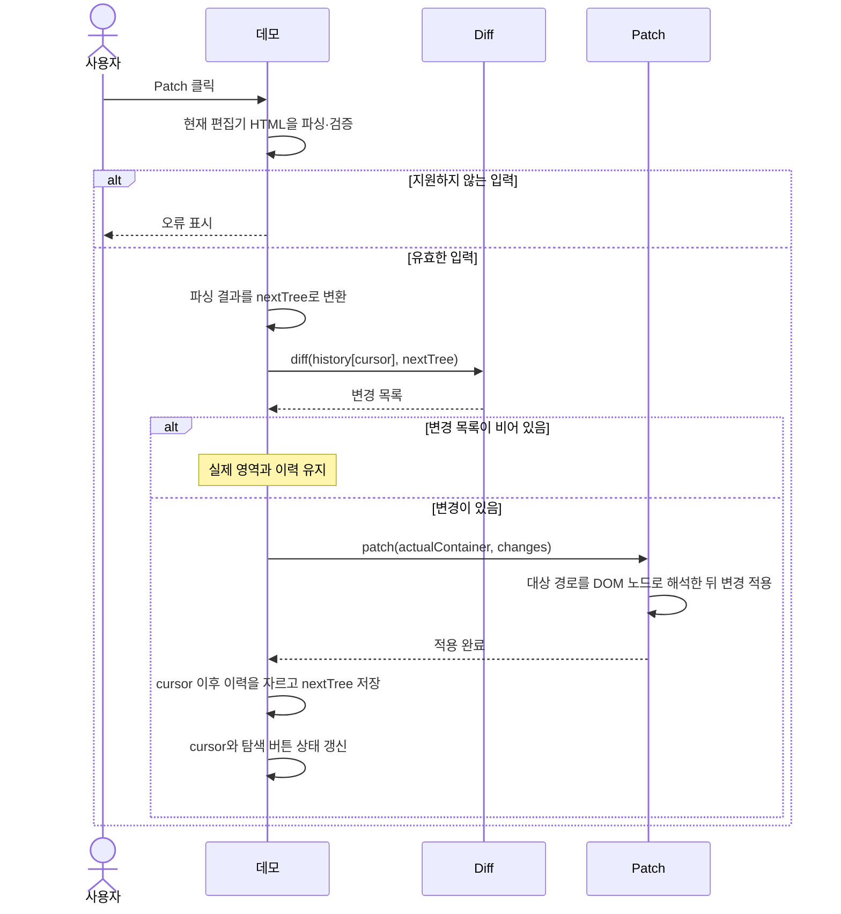
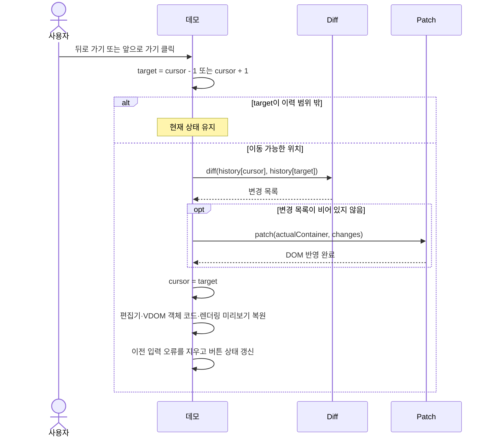

# mini-react Phase 1 명세

사용자가 테스트 영역의 HTML을 편집한 뒤 `Patch`를 누르면, 변경된 부분이 실제 영역에 반영된다. 적용한 화면은 VDOM 스냅샷으로 저장한다. **뒤로 가기**와 **앞으로 가기**로 실제 화면, 편집기, VDOM 표시를 함께 복원할 수 있다.

## 1. 화면과 사용자 흐름

### FR-001 초기 화면

| 화면 요소 | 역할 |
|---|---|
| 실제 영역 (Real DOM) | 초기 샘플 HTML과 Patch로 반영된 화면을 보여 준다. |
| 테스트 영역 | 샘플 HTML을 수정하는 편집기와 VDOM 표시를 제공한다. |
| Virtual DOM 패널 | VNode 트리 전체를 `const vdom = { ... };` 형태의 JavaScript 객체 코드로 기본 표시한다. 렌더링 결과는 별도 미리보기를 펼쳐 확인할 수 있다. |
| 조작 버튼 | `Patch`, **뒤로 가기**, **앞으로 가기**를 제공한다. |
| 이력 표시 | 저장한 스냅샷 수와 현재 위치를 보여 준다. |

페이지를 로드하면 실제 영역의 샘플 DOM에서 초기 VDOM을 만든다. 편집기에 샘플 HTML을 표시하고 같은 VDOM으로 객체 코드와 렌더링 미리보기를 채운다. 초기 VDOM을 이력의 첫 항목으로 저장한다. 커서는 `0`, 화면의 이력 표시는 **1개**, 현재 위치는 **1 / 1**이다.

### FR-002 편집한 HTML 적용

편집기가 입력 이벤트를 받으면 현재 HTML을 파싱하고 검증한다. 유효하면 테스트 영역의 객체 코드와 렌더링 미리보기를 갱신한다. 유효하지 않으면 오류를 표시하고 마지막으로 유효했던 객체 코드와 미리보기를 유지한다. 편집 중에는 실제 영역에 적용하거나 스냅샷을 저장하지 않는다.

`Patch`를 누르면 현재 편집기 HTML을 다시 파싱하고 검증한다. 유효한 VDOM을 현재 이력의 스냅샷과 비교한다. 유효하지 않은 입력이나 빈 변경 목록은 실제 영역, 이력 배열, 커서를 유지한다. 유효한 변경이 있으면 실제 영역에 해당 작업을 적용한다. 적용 성공 뒤 FR-008에 따라 이력을 저장한다.

#### HTML 입력 범위

- 분리된 `<template>`에서 HTML 조각을 파싱하고, 파싱 결과의 모든 요소를 검사한다. 빈 입력과 최상위 노드가 여러 개인 입력도 받는다. 관리하는 영역은 하나의 `<div>` 루트로 감싼다.
- HTML 요소 중 `article`, `b`, `br`, `button`, `code`, `div`, `em`, `h1`, `h2`, `h3`, `hr`, `i`, `input`, `label`, `li`, `ol`, `p`, `pre`, `section`, `small`, `span`, `strong`, `ul`을 지원한다.
- 공통 속성은 `id`, `class`, `title`, 이름이 붙은 `data-*`와 `aria-*`다. `data-key`는 FR-007에 따라 읽는다.
- `input`은 기본 텍스트 입력, `type="text"`, `type="checkbox"`를 지원한다. 타입을 비교할 때 대소문자를 구분하지 않는다. `input`에 `type`, `value`를 사용할 수 있고 `checked`는 체크박스에서 사용할 수 있다.
- 지원 범위 밖의 태그·네임스페이스·속성·입력 타입이나 중복 `data-key`가 있으면 오류를 표시한다.
- 주석은 생략하고, 주석 때문에 나뉘었던 인접 텍스트는 합친다. 브라우저가 파싱한 텍스트의 내용과 공백은 보존한다.



### FR-003 이전·다음 이력으로 이동

이전 위치는 `cursor - 1`, 다음 위치는 `cursor + 1`이다. 이동할 스냅샷이 없는 방향의 버튼은 비활성화한다. 이동할 수 있으면 현재 스냅샷과 대상 스냅샷을 비교하고, 변경 목록이 있을 때 실제 영역에 적용한다. 커서를 대상 위치로 옮긴 뒤 선택한 스냅샷으로 편집기 HTML, VDOM 객체 코드, 렌더링 미리보기를 복원한다. 이전 입력 오류를 지우고 탐색 버튼과 위치 표시를 갱신한다.

복원된 편집기 HTML을 다시 파싱하면 선택한 스냅샷과 같은 VDOM을 얻어야 한다. 이 조건은 `<pre>`의 첫 줄바꿈을 포함해 스냅샷이 가진 공백에도 적용한다.



### FR-004 변경 영역과 이력 위치 표시

`Patch` 또는 이력 이동으로 실제 영역이 바뀌면 변경된 부분을 빨간색으로 2초간 강조한다. 텍스트 변경은 이를 담은 요소를, 노드 삭제는 삭제가 일어난 부모 영역을 강조한다. 이력 개수는 `history.length`, 현재 위치는 `cursor + 1`을 전체 개수와 함께 표시한다.

## 2. VDOM 자료구조

### FR-005 Phase 1 VNode

VDOM은 실제 DOM과 별도로 화면의 구조와 값을 담는 JavaScript 객체다. 트리 전체는 루트 `VNode` 하나로 표현한다. 요소는 `type: 1`, 텍스트는 `type: 3`을 사용한다. 다음 TypeScript 선언은 타입 검사에 사용하는 구조를 설명한다.

```ts
enum VNodeType {
  ELEMENT = 1,
  TEXT = 3,
}

interface VElement {
  type: VNodeType.ELEMENT;
  tagName: string;
  key?: string;
  props: Record<string, string>;
  children: VNode[];
}

interface VText {
  type: VNodeType.TEXT;
  value: string;
}

type VNode = VElement | VText;
```

다음 버튼 HTML을 VDOM으로 표현한다.

```html
<button class="likes">좋아요 10</button>
```

```ts
const tree: VElement = {
  type: VNodeType.ELEMENT,
  tagName: "button",
  props: { class: "likes" },
  children: [{ type: VNodeType.TEXT, value: "좋아요 10" }],
};
```

`type`으로 두 종류를 구분하므로 `children` 안에 요소와 인라인 텍스트 객체를 함께 담을 수 있다. Phase 1의 `props`에는 문자열 HTML 속성을 담는다. 실제 DOM 프로퍼티와 이벤트 핸들러를 표현하는 타입은 Phase 2에서 검토한다.

## 3. 변환·비교·반영 함수

| 모듈 | 호출 예시 | 책임 |
|---|---|---|
| VDOM 변환 | `fromDOM(domNode)` | HTML 요소는 태그, 문자열 속성, 선택적 키와 자식 목록을 담고, 텍스트는 `value`를 담는다. 주석은 변환 대상에서 건너뛴다. |
| DOM 생성 | `toDOM(vnode)` | 텍스트는 `value`로 만들고, 요소는 `tagName`으로 생성한 뒤 `props`와 `key`를 속성에 반영하고 자식을 원래 순서대로 연결한다. |
| 비교 | `diff(oldTree, newTree)` | 두 루트 VNode를 깊이 우선 탐색(DFS)으로 비교해 순서가 있는 변경 목록을 반환한다. |
| 갱신 | `patch(actualContainer, changes)` | 대상 경로를 적용 전 DOM의 노드로 해석한 뒤 변경 목록을 순서대로 적용한다. |

### FR-006 Diff 변경 종류

루트에서 비교를 시작한다. 유지할 수 있는 요소는 속성과 자식을 비교한다. 타입이나 태그가 달라 교체하는 경우 해당 노드를 루트로 하는 하위 트리 전체가 교체 대상이다.

| 조건 | 수행 작업 |
|---|---|
| 이전 노드 없음, 새 노드 있음 | `INSERT` |
| 이전 노드 있음, 새 노드 없음 | `REMOVE` |
| 노드 타입이 다름 | `REPLACE` |
| 둘 다 요소이고 `tagName`이 다름 | `REPLACE`. 같은 키여도 적용한다. |
| 둘 다 텍스트이고 `value`가 다름 | `UPDATE_TEXT` |
| 유지할 요소의 `props`가 다름 | `UPDATE_PROPS`. 사라진 속성은 실제 DOM에서 제거한다. |
| 요소를 유지할 수 있음 | 자식끼리 재귀적으로 비교한다. |
| 유지할 키 노드의 위치가 달라짐 | `MOVE` |
| 새 자식 목록이 비어 있음 | 기존 자식을 모두 `REMOVE`한다. |
| 같은 부모 아래에서 `key` 중복 | 오류 처리 |

예를 들어 게시글의 `<span><strong>좋아요 10</strong></span>`이 `<p><strong>좋아요 10</strong></p>`으로 바뀌면 해당 하위 트리를 교체한다. 사과와 바나나가 있는 목록 끝에 포도를 추가할 때는 기존 두 항목을 유지하고 포도 노드를 삽입한다.

#### 변경 목록과 경로

각 작업에는 `type`과 `path`가 있다. 경로는 실제 영역 컨테이너를 기준으로, 적용 전 DOM에서 요소와 텍스트 자식만 세어 만든 0부터 시작하는 인덱스 배열이다. 예를 들어 `[]`는 컨테이너, `[0]`은 첫 번째 루트 노드다. 주석은 인덱스에서 제외한다.

| 작업 | `path` 대상 | 추가 필드 |
|---|---|---|
| `INSERT` | 삽입할 부모 | `node`, 삽입할 자식 위치 `index` |
| `REMOVE` | 삭제할 노드 | |
| `REPLACE` | 교체할 노드 | `node`, 교체하면서 위치가 바뀌면 `index` |
| `UPDATE_TEXT` | 텍스트 노드 | 새 문자열 `value` |
| `UPDATE_PROPS` | 요소 노드 | 추가·변경할 속성 맵 `set`, 삭제할 속성 이름 배열 `remove` |
| `MOVE` | 같은 부모 안에서 이동할 노드 | 이동 후 자식 위치 `index` |

Patch는 적용 전에 경로가 가리키는 기존 DOM 노드와 부모를 해석한다. `index`는 해당 작업을 적용할 시점의 0부터 시작하는 자식 위치다. 이동·재배치할 때는 해당 노드를 현재 위치에서 뺀 뒤의 목록을 기준으로 위치를 계산한다.

### FR-007 형제 노드 매칭과 이동

요소의 HTML `data-key` 속성값을 선택적 문자열 `key`로 읽는다. `data-key`는 `props`와 별도로 담고, `toDOM`은 `key`를 `data-key` 속성으로 생성한다. 같은 부모 아래의 키는 유일해야 한다. 같은 항목을 이어서 렌더링할 때는 예를 들어 `<li data-key="post-42">`의 키를 유지한다.

| 상황 | 대응 기준 또는 작업 |
|---|---|
| 키가 없는 일반 노드 | 같은 위치의 키 없는 노드와 대응한다. 타입과 태그로 재사용 여부를 정한다. |
| 키가 있는 노드 | 같은 부모 아래에서 같은 키를 찾는다. 타입과 태그로 재사용 여부를 정한다. |
| 같은 키의 태그가 바뀜 | 해당 하위 트리를 교체한다. |
| 같은 키의 노드를 재사용하고 위치가 바뀜 | 기존 DOM 노드 객체를 이동한다. |
| 키가 추가되거나 사라짐 | 대응하는 노드를 삽입하거나 삭제한다. |

부모별로 이전 자식의 키를 모아 대응표를 만든다. 새 자식 목록을 왼쪽부터 순회하며 이전 노드를 찾고, 유지할 수 있으면 내용을 비교해 필요할 때 위치를 옮긴다. 기존 목록의 `A`(포도), `B`(사과), `C`(바나나)가 `[B, C, A]` 순서로 바뀌면 기존 `B`를 첫 위치에, `C`를 두 번째 위치에 놓는다. 결과는 사과, 바나나, 포도 순서다.

## 4. State History

### FR-008 스냅샷과 커서

실제 영역에 반영된 VDOM 스냅샷을 최대 10개 보관한다. `history[cursor]`는 현재 실제 영역의 스냅샷이다.

```js
const history = [initialTree];
let cursor = 0;
```

| 동작 | 이력 | 커서 |
|---|---:|---:|
| A에서 시작 | `[A]` | `0` |
| B, C를 차례로 적용 | `[A, B, C]` | `2` |
| 뒤로 가서 B 표시 | `[A, B, C]` | `1` |
| B에서 변경 없이 Patch | `[A, B, C]` | `1` |
| B에서 새 변경 D를 적용 | `[A, B, D]` | `2` |

`Patch`가 유효한 새 변경을 실제 영역에 적용하면 커서 뒤의 항목을 삭제하고 새 스냅샷을 추가한다. 저장 항목이 10개를 넘으면 가장 오래된 항목을 제거한다. 배열을 정리한 뒤 커서를 새 스냅샷이 있는 마지막 인덱스로 맞춘다. 이력 이동은 배열에 항목을 추가하거나 삭제하지 않는다.

## 5. 완료 조건

| 확인 흐름 | 기대 결과 |
|---|---|
| 첫 로드 | 실제 영역과 렌더링 미리보기에서 샘플이 일치한다. Virtual DOM 패널에서 해당 트리의 JavaScript 객체 코드를 바로 볼 수 있고, 이력은 1개이며 위치는 1 / 1이다. |
| 편집 중 유효한 입력 | 객체 코드와 렌더링 미리보기가 편집한 HTML의 VDOM으로 갱신된다. 실제 영역과 이력은 이전 반영 상태를 유지한다. |
| HTML 편집 후 유효한 Patch | 변경된 실제 DOM만 갱신된다. 바뀐 영역은 2초간 빨갛게 강조되고, 새 스냅샷과 이력 위치가 표시된다. |
| 지원하지 않는 입력 또는 변경 없는 Patch | 실제 영역과 이력 배열, 커서를 유지한다. 지원하지 않는 입력에는 오류를 표시하고 마지막 유효 VDOM 표시를 유지한다. |
| 뒤로·앞으로 이동 | 배열 항목 수를 유지한다. 실제 영역·편집기·객체 코드·미리보기를 선택한 스냅샷으로 복원하고, 바뀐 실제 영역을 2초간 강조한다. |
| 이력 복원 직후 편집 없이 Patch | 변경 목록이 비어 있으며 실제 영역, 이력 배열, 커서를 유지한다. `<pre>`에 첫 줄바꿈이 있는 스냅샷으로도 확인한다. |
| B에서 새 변경 D 적용 | `[A, B, C]`의 B에서 Patch하면 `[A, B, D]`가 된다. |
| 이력이 10개인 상태에서 끝에 새 변경 추가 | 가장 오래된 항목을 제거한다. 이력은 10개, 위치는 10 / 10이다. |
| 키가 있는 목록의 재정렬과 태그 변경 | 재정렬은 기존 DOM 노드 객체를 이동한다. 타입이나 태그가 바뀌면 해당 하위 트리가 교체된다. |
| 같은 부모 아래에서 키 중복 | 입력 오류가 표시되고 실제 영역과 이력 배열, 커서를 유지한다. |
| VNode 타입 예시 검사 | 버튼 예제의 인라인 텍스트 객체를 `VElement.children`에 넣으면 타입 검사를 통과한다. |

### 결정 근거

- 사용자가 Virtual DOM 패널을 JavaScript 객체 코드로 보여 달라고 지정했다. 렌더링 미리보기는 펼쳐 확인하는 방식으로 연결한다.
- HTML 입력 범위, `data-key` 매핑, 변경 경로, 미리보기 갱신 시점, 이력 상한 처리 방식은 위임된 Phase 1 구현에서 선택하고 구현 결과로 알린 규칙을 반영했다.
- 사용자 이해 확인 상태는 미확인이다. 동작 확인은 위 완료 조건의 실행 검증으로 판정한다.
